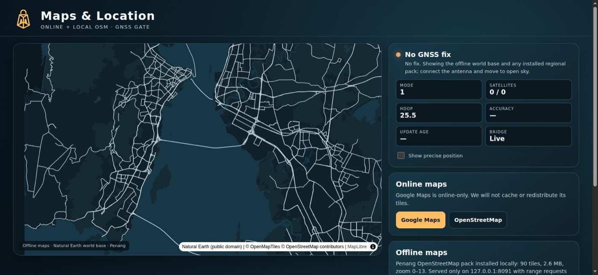
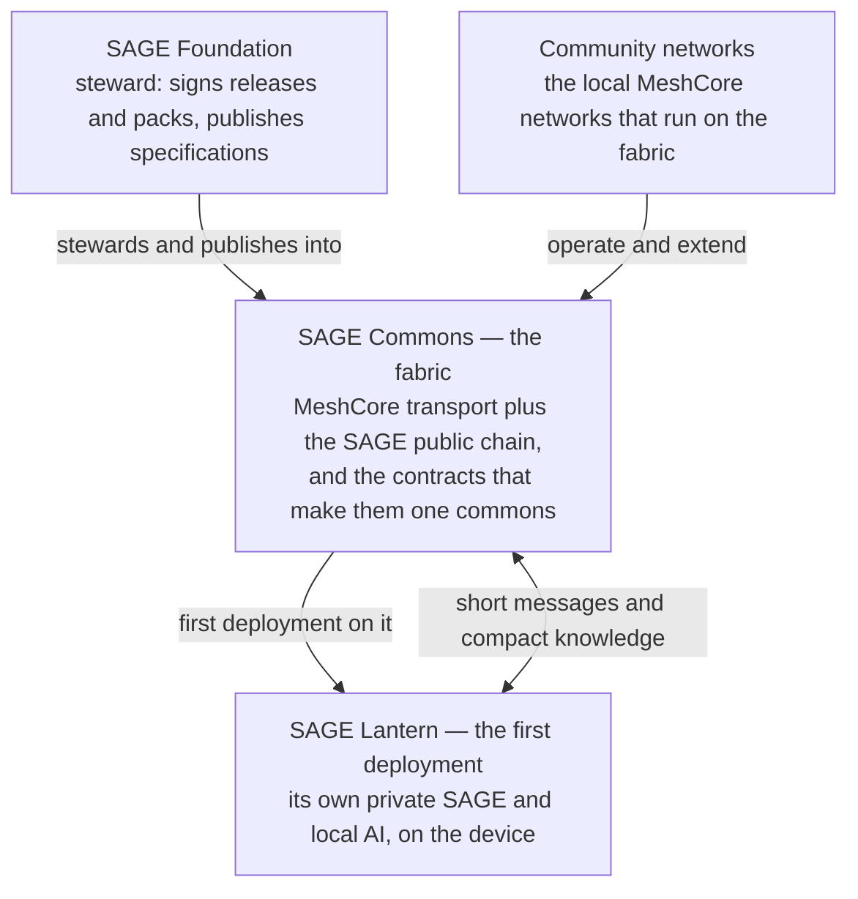

<p align="center">
  
</p>

<h1 align="center">SAGE Lantern</h1>

<p align="center"><strong>Intelligence. For all of us.</strong></p>

<p align="center">
  <a href="docs/lantern/DELIVERY_BACKLOG.md"></a>
  <a href="LICENSE"></a>
  <a href="maps/README.md"></a>
</p>


<p align="center"><em>Concept illustration of the Lantern device. Not a photograph of a produced unit.</em></p>

A [SAGE Foundation](https://sage-foundation.net/) project, created and maintained by [Dhillon Andrew Kannabhiran (@l33tdawg)](https://github.com/l33tdawg). Part of the broader [SAGE project](https://github.com/l33tdawg/sage/).

**Development preview, public since 19 October 2026.** This is the product repository for the Lantern device: runtime, touchscreen apps, provisioning tools, firmware glue and the offline map packs. The [Foundation site](https://sage-foundation.net/) carries the programme and contact details. [Offline maps](maps/README.md) are published as release assets. [Device status](docs/lantern/DELIVERY_BACKLOG.md) records what is proven and what is not.

[Documentation](docs/index.md) · [Project family](#the-sage-project-family) · [Lantern 3B model](https://github.com/l33tdawg/lantern-3b) · [Offline maps](maps/README.md) · [Security](SECURITY.md) · [Contributing](CONTRIBUTING.md)

A curious mind shouldn't need a better postcode. SAGE is an initiative to
democratise intelligence: local AI that works without reliable internet, and
community-owned networks that keep people connected when the usual connections
don't. SAGE Commons is the fabric underneath that: core mesh technology and a
governed public network that community networks, services and devices join.
SAGE Lantern is the first deployment on it.

This repository is the development home of that work: device runtime,
touchscreen interface, firmware, provisioning tools, public website and the
engineering documentation behind them. It opened publicly on 19 October 2026,
ahead of the January 2027 launch plan, so the device work and map packs can be
reviewed and used now. Opening the repository does not change the device's
acceptance status.

Current device allocation: **A/B are single-LoRa Lamplighter, administration,
knowledge delivery and repeater support units with dashboard screens. C–F are
the current bench and acceptance Lanterns: Orange Pi 5 Plus, one LoRa baseline
radio, an optional second radio, GPS and WiFi via the Pi. G/H are the next user
units on the ROCK 5B+.** See the [device-role map](docs/lantern/DEVICE_ROLES.md)
for verified readiness and remaining integration work. Unit C is the first unit
running the 3B chat model as its live device lane; V79.6 remains the rollback.

## What we're building

### The SAGE project family

| Project | Repository and scope |
| --- | --- |
| **SAGE** | [Main SAGE repository](https://github.com/l33tdawg/sage/) — agent memory, governance and core infrastructure. |
| **Meshticulum** | [Meshticulum](https://github.com/l33tdawg/meshticulum) — reusable transport, reliable flow, radio and IP carrier work, and verified resource protocols. |
| **Lantern 3B** | [Model repository](https://github.com/l33tdawg/lantern-3b) — weights, adapter chain, guard, model card and evaluation. Non-commercial research preview. |
| **Lantern** | This repository — product apps and UI, device provisioning, runtime orchestration and private SAGE integrations. |

Lantern consumes the SAGE SDK and Meshticulum. Neither depends on Lantern. The
model weights live in [lantern-3b](https://github.com/l33tdawg/lantern-3b).
See [project family and repository boundaries](docs/PROJECT_FAMILY.md) for the
ownership detail.

**Meshticulum** is the reusable transport underneath Lantern: authenticated
messages, reliable flow, and verified resources across LoRa and IP. It is
public as `1.0.0-alpha`, with the tested SDK wheel, source archive, firmware
build path, notices and proof records. Start with the
[repository](https://github.com/l33tdawg/meshticulum),
[project site](https://l33tdawg.github.io/meshticulum/),
[alpha release](https://github.com/l33tdawg/meshticulum/releases/tag/v1.0.0-alpha),
[documentation](https://github.com/l33tdawg/meshticulum/blob/main/docs/index.md)
or the [HTTP gateway notes](https://github.com/l33tdawg/meshticulum/blob/main/docs/HTTP_GATEWAY.md).
Its published figures are near-bench application goodput, not field-range or
carrier-capacity claims.

**Lantern 3B** is the language model inside the device: a guarded 3B English
research preview built on Qwen2.5-VL-3B-Instruct. Start with the
[model repository](https://github.com/l33tdawg/lantern-3b), the
[model card](https://github.com/l33tdawg/lantern-3b/blob/main/MODEL_CARD.md)
or the
[V81 research preview](https://github.com/l33tdawg/lantern-3b/releases/tag/v81-research-preview).
The adapter chain is non-commercial research material under the Qwen Research
License. The guard is part of the contract for saves and recalls; the weights
alone are not qualified for general assistance or long-form writing.

### The Foundation and the mission

SAGE Foundation is an initiative in formation. It exists to steward the
mission, not to own the commons: it holds releases, the signing trust root and
public reporting, and it is designed to hand them on. It is not a registered
entity, holds no funds on anyone's behalf, and this site does not take payments
or device orders. It does not hold private knowledge, the commons itself or the
MeshCore standard; each shared item records its own licence.

The mission is to democratise intelligence: help people learn, create and solve
problems regardless of income or connectivity. That means local AI that works
without a reliable network, community-owned radio networks that keep working
during outages, and a public knowledge commons built from deliberate, reviewed
contributions. Private knowledge stays on the owner's device unless they choose
to share it.

Read more at [sage-foundation.net](https://sage-foundation.net/). The
[Foundation page](https://sage-foundation.net/foundation/#limits) sets out what
it holds and what it does not, with the
[ownership table](https://sage-foundation.net/foundation/#ownership) beside it.
[SAGE Commons](https://sage-foundation.net/commons/) explains how the parts fit,
and [Lantern hardware](https://sage-foundation.net/hardware/) covers the device
programme. To talk about the mission, a build or a community pilot, write to
[dhillon@sage-foundation.net](mailto:dhillon@sage-foundation.net).


<p align="center"><em>AI illustration of the mission. Not a photograph of a deployed pilot.</em></p>

**SAGE Lantern — a handheld AI companion.** A 6.25-inch portrait touchscreen, a
physical hold-to-talk control, an outward camera for visual questions and an
external USB-C supply chosen by the owner, running local intelligence on an
Orange Pi 5 Plus (RK3588) platform. Ask a question, explore an idea, or work
through a problem with the model running on the device itself.

**Community connections.** Every Lantern is intended to join a local MeshCore
radio network for short messages and shared knowledge, with community gateways
planned to carry authorised requests beyond the local mesh when backhaul is
available. Local AI and short radio messages are the fallback that keeps
working during outages.

**The commons fabric.** SAGE Commons is the fabric the devices join: MeshCore
transport plus the SAGE public chain, with the contracts that make them one
interoperable, community-owned commons. One person's discovery can become
everyone's possibility, deliberately and only that far: personal knowledge
stays personal, and anything shared is reviewed before it travels.

### Offline maps



The device ships with a Natural Earth world overview. Detailed regions arrive
as separate packs, each with a manifest and a SHA-256. Five selected regional
areas are published now: Penang, Malaysia, Klang Valley, Singapore and Johor
Bahru. The catalog is machine-readable, and the installer checks every byte
before a pack lands.

[Browse the map packs](maps/README.md) · [Download the release](https://github.com/l33tdawg/sage-lantern/releases/tag/maps-20261019)

## How it works

### The parts, and how they relate



The Foundation does not own the fabric and does not hold the networks. It signs
what it publishes, stewards the specifications and holds the trust root; the
networks belong to whoever runs the nodes, and each Lantern's private knowledge
belongs to its owner.

### How knowledge moves: private, then public, then offline again

```mermaid
flowchart LR
  A["Private knowledge on a Lantern<br/>the owner's own SAGE"] -->|"deliberate share:<br/>sanitised derivative"| B["Signed proposal envelope<br/>bound to a nonce and timestamp"]
  B --> C["Commons intake and quarantine<br/>schema, licence, policy and abuse checks"]
  C -->|"approved"| R["The Lantern submits again<br/>under its ordinary proposer identity"]
  R --> D["Independent validators<br/>public-chain consensus"]
  D --> E["Committed public knowledge<br/>with checkable provenance"]
  E --> F["Signed knowledge packs<br/>content-addressed, licence per item"]
  F -->|"radio, peer swap or removable media"| G["Another Lantern<br/>verified offline, no account, no connection"]
```



Nothing leaves a device by default. A share is a bounded, signed derivative;
public knowledge is carried as signed packs that any copy can verify without an
account or a connection. The public chain, intake and the pack channel are
specified in [`docs/MASTER_TECHNICAL_PRD.md`](docs/MASTER_TECHNICAL_PRD.md) and
[`docs/lantern/KNOWLEDGE_PACK_V2.md`](docs/lantern/KNOWLEDGE_PACK_V2.md); how
much of it runs today is in the next section, not in these diagrams.

## Where the project actually is

Honesty is a design requirement here. Implemented, staged, deployed and
physically accepted are separate milestones, and this repository treats them
that way.

- **Two test units (A and B) are built and running.** Local voice, on-device
  answers, camera capture, the touchscreen interface and the radio foundation
  are under active integration and validation. The fleet build in flight is
  C–H. The ROCK 5B+ tub, firmer bezel and back cover have been printed and
  accepted as mechanical trials. No complete unit has passed electrical,
  thermal or field acceptance, and the gasket and antenna-collar trials remain
  open.
- **Unit C runs the V81 3B chat model.** The device artifact is the RK3588
  W8A8 opt1 export with 16k context and 8k output, served on loopback port
  8081 through the RKLLM token engine and response guards. The 48-request
  streaming run measured 726.7 ms median TTFT and 7.93 tok/s median decode on
  one unit; the 36 quality prompts measured 646.9 ms and 7.96 tok/s. Those are
  latency figures, not a correctness or thermal claim. V79.6 remains the
  rollback. See
  [`docs/lantern/3B_MODEL_PRODUCTION.md`](docs/lantern/3B_MODEL_PRODUCTION.md).
- **Meshticulum 1.0.0-alpha is public; Lantern messaging is not yet a verified
  end-to-end service.** The protocol/transport project is released at
  [`l33tdawg/meshticulum` v1.0.0-alpha](https://github.com/l33tdawg/meshticulum/releases/tag/v1.0.0-alpha)
  from source `673eb60…`, package `1.0.0a1`. Its published results are
  near-bench application goodput (GFSK250 about 2.0 kB/s; one LoRa SF7/BW500
  run at 1.07 kB/s), not field-range, modulation-equivalence or
  upstream-superiority claims. Lantern's transport, storage, contacts and
  discovery exist; real message exchange, delivery and read receipts still
  have open acceptance gates.
- **Hardware imagery is an AI-generated concept**, not a photograph of a
  product. Final dimensions, screen resolution, battery runtime and pricing
  will be published after validation.
- **The campaign figure is an ambition, not funds raised.** Programme delivery
  plans live in [`docs/roadmap/`](docs/roadmap/); campaign, funding and
  federation research is kept privately outside this tree.

The device acceptance gate is
[`docs/lantern/DELIVERY_BACKLOG.md`](docs/lantern/DELIVERY_BACKLOG.md). Treat it
as the current source of truth for what is proven and what is still open.

## Build a Lantern

| Guide | What it covers |
| --- | --- |
| [Hardware overview](hardware/README.md) | Device roles, current status and safety notes |
| [Bill of materials](hardware/BILL_OF_MATERIALS.md) | Parts, quantities and what is still pending |
| [Printable parts](hardware/stl/README.md) | STL folder and print-file conventions; nothing published yet |
| [Build guide](docs/build/README.md) | The full build path and what it assumes |
| [Assembly](docs/build/ASSEMBLY.md) | Physical build sequence for the C-F unit |
| [First boot](docs/boot/FIRST_BOOT.md) | Owner setup, networking and service checks |
| [Recovery](docs/boot/RECOVERY.md) | Rollback and evidence preservation |

## Repository layout

| Path | What lives there |
| --- | --- |
| [`hardware/`](hardware/) | Hardware overview, bill of materials and printable parts |
| [`software/runtime/`](software/runtime/) | Device runtime: local voice loop, mesh/LoRa broker and transport, SAGE vault integration, storage-supervisor lifecycle, audio readiness, device lock and community services |
| [`software/npu/`](software/npu/) | RKLLM text and vision engines, HTTP servers, response guards and the Unit C 3B deployment notes |
| [`apps/lantern-fleet-admin/`](apps/lantern-fleet-admin/) | Device touchscreen UI and local fleet-admin console (Next.js/React): ask-and-answer flow, history, messages, camera, sharing, settings and read-only operator views |
| [`apps/sage-website/`](apps/sage-website/) | Public site at [sage-foundation.net](https://sage-foundation.net/), with sage.ngo and sage-commons.org forwarding; mission, hardware and programme copy exported as static files |
| [`firmware/`](firmware/) | Espressif audio-bridge project and the MeshCore companion-radio patch series used by the units |
| [`scripts/lantern/`](scripts/lantern/) | Provisioning, installers, update and recovery tooling, evidence capture and acceptance runners |
| [`docs/lantern/`](docs/lantern/) | Device PRD, hardware BOM and contract, bring-up and validation, protocol notes, acceptance evidence, delivery backlog |
| [`docs/`](docs/) | Programme, architecture, distribution, roadmap, governance and open-source policy documents |
| [`deploy/`](deploy/) | Server-side configuration used by the hosted services |
| [`maps/`](maps/) | Offline map pack catalog, licence notes and install commands |

`docs/` is the published documentation tree: device, hardware and engineering
material only. Business material — pitch decks, exported programme documents,
concept imagery, and funding, campaign or federation research — lives locally in
`internal-docs/` (`pitch/`, `imagery/`, `funding/`), which git ignores. Local
development evidence in `work/` and `evidence/` is likewise not published.

## Building and testing

Prerequisites: Node 22+ for the web apps, Python 3.11+ for the runtime, and the
respective vendor toolchains for firmware.

```bash
# Device UI and fleet console
cd apps/lantern-fleet-admin
npm ci
npm test          # unit tests
npx tsc --noEmit  # typecheck
npm run build     # production build

# Public website
cd apps/sage-website
npm ci
npm run build     # static export into dist/client

# Device runtime
cd software/runtime
PYTHONPATH=src python3 -m pytest tests

# Read-only platform snapshot on a Lantern unit
./scripts/capture-lantern-evidence.sh evidence/<test-id>
```

Firmware builds and device provisioning are documented in
[`docs/lantern/`](docs/lantern/) and [`scripts/lantern/`](scripts/lantern/);
they expect the pinned toolchains and the unit's own identity material.

## Design principles

1. **Offline first.** Local questions are answered on the device. Connectivity
   adds capability; it is never a dependency for the core experience.
2. **Private by default, shared on purpose.** Personal knowledge stays in the
   owner's vault. Anything that leaves it — a message, a public share, a photo —
   requires explicit consent and a bounded, reviewable path.
3. **No fabricated success.** Measurements, receipts and acceptance evidence are
   recorded; a component is not "done" because it deployed or because an order
   confirmation arrived.
4. **Serviceable and understandable.** Replaceable packs, ventilated
   enclosures, documented pinouts and repair paths are part of the design, not
   an afterthought.
5. **Honest limits.** Radio bandwidth is bounded, coverage needs repeaters and
   power, and satellite service can be unavailable. The documentation says so.

## Documentation map

Start with these, then follow the links inside them:

- [`docs/lantern/PRD.md`](docs/lantern/PRD.md) — product intent, scope and acceptance criteria.
- [`docs/lantern/DELIVERY_BACKLOG.md`](docs/lantern/DELIVERY_BACKLOG.md) — current device gate, verified state and open work.
- [`docs/lantern/3B_MODEL_PRODUCTION.md`](docs/lantern/3B_MODEL_PRODUCTION.md) — V81 3B production deployment, device timings, guards, rollback and known limits.
- [`docs/lantern/HARDWARE_SOFTWARE_CONTRACT.md`](docs/lantern/HARDWARE_SOFTWARE_CONTRACT.md) — the hardware/software ownership boundary.
- [`docs/lantern/HARDWARE_BOM.md`](docs/lantern/HARDWARE_BOM.md) — the A/B test-unit parts list and order history as of 11 September 2026. Superseded for the C–F fleet build, which the hardware workstream records in its own bill of materials and build status; kept here as the bring-up record.
- [`docs/lantern/BRINGUP_AND_VALIDATION.md`](docs/lantern/BRINGUP_AND_VALIDATION.md) — staged assembly, test procedure and evidence checklist.
- [`docs/lantern/UNIT_A_ACCEPTANCE_EVIDENCE.md`](docs/lantern/UNIT_A_ACCEPTANCE_EVIDENCE.md) — Unit A build, offline voice, timing and recovery evidence.
- [`docs/lantern/SSH_MANAGEMENT.md`](docs/lantern/SSH_MANAGEMENT.md) — operator access, the `sage` maintenance account and key rotation.
- [`docs/lantern/MESHCORE_TRANSPORT_PROTOCOL.md`](docs/lantern/MESHCORE_TRANSPORT_PROTOCOL.md) and [`MESHCORE_HOST_PROTOCOL_TEST_PLAN.md`](docs/lantern/MESHCORE_HOST_PROTOCOL_TEST_PLAN.md) — the radio protocol as implemented and its test matrix.
- [`docs/MASTER_TECHNICAL_PRD.md`](docs/MASTER_TECHNICAL_PRD.md), [`docs/TERMINOLOGY.md`](docs/TERMINOLOGY.md) and [`docs/DOCUMENTATION_GOVERNANCE.md`](docs/DOCUMENTATION_GOVERNANCE.md) — programme contract, canonical vocabulary and document hierarchy.
- [`docs/OPEN_SOURCE_POLICY.md`](docs/OPEN_SOURCE_POLICY.md) and [`GOVERNANCE.md`](GOVERNANCE.md) — licensing scope and how decisions are made.

## Direction and roadmap

## Direction

This repository is public now. Device launch, campaign and order dates are
separate decisions and are not announced here. The current work is to qualify
C-F and bring up the first G/H unit. The next hardware gate is the remaining
first-article prints and a measured tolerance report. A supported community
pilot remains a proposal.

## Contact

SAGE Foundation is an initiative in formation, and Lantern is in development.
To talk about the mission, the hardware or a community pilot, write to
<dhillon@sage-foundation.net>.

## Contributing, security and licence

- Contributions: read [`CONTRIBUTING.md`](CONTRIBUTING.md) and the documentation
  governance rules before opening a change. Cross-subsystem, security, privacy,
  protocol or governance changes need an RFC; durable local choices need an ADR.
- Security: report vulnerabilities through [`SECURITY.md`](SECURITY.md) rather
  than a public issue.
- Licence: project-authored code, documentation, schemas and tests are
  [Apache-2.0](LICENSE). Third-party models, data, voices, firmware and other
  artifacts keep their upstream licences — see
  [`docs/OPEN_SOURCE_POLICY.md`](docs/OPEN_SOURCE_POLICY.md) and [`NOTICE`](NOTICE).
