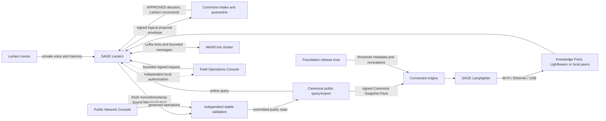

# SAGE Commons master technical product requirements document

**Document ID:** SC-MTPRD  
**Version:** 0.1.0  
**Status:** CANDIDATE programme baseline  
**Last updated:** 2026-08-09  
**Product owners:** SAGE product owners / future SAGE Commons Foundation  
**Engineering ownership:** subsystem maintainers named in the traceability register  
**Licence:** Apache-2.0  
**Time horizon:** 3–5 years minimum  
**Core compatibility baseline:** SAGE v11.18.4 until an accepted compatibility RFC changes it

## 1. Purpose

This document is the normative spine for SAGE Commons. It defines the complete product boundary, invariants, system decomposition, authority model, data lifecycles, subsystem contracts, quality bars and delivery programme. Detailed specifications remain modular and are linked from here; they are part of the product contract rather than optional background reading.

The programme is not “a device plus a blockchain.” It is an offline-capable public knowledge ecosystem in which people retain sovereign private local AI, may intentionally propose sanitized public knowledge, and can receive verifiable software/model/knowledge updates even where internet connectivity is intermittent or absent.

### 1.1 Normative language

Uppercase `MUST`, `MUST NOT`, `SHOULD`, `SHOULD NOT` and `MAY` have RFC 2119/8174 meanings. Requirement IDs remain stable and are tracked in [`REQUIREMENTS_TRACEABILITY.md`](REQUIREMENTS_TRACEABILITY.md). Unresolved choices are not decisions; they live in [`OPEN_DECISIONS.md`](OPEN_DECISIONS.md).

### 1.2 Document set

This PRD incorporates by reference:

- Lantern: [`lantern/PRD.md`](lantern/PRD.md), [`lantern/HARDWARE_SOFTWARE_CONTRACT.md`](lantern/HARDWARE_SOFTWARE_CONTRACT.md), [`lantern/SOFTWARE_STACK.md`](lantern/SOFTWARE_STACK.md), [`lantern/DUAL_HOME_AND_PUBLICATION_CONTRACT.md`](lantern/DUAL_HOME_AND_PUBLICATION_CONTRACT.md).
- Administration: [`admin/LANTERN_FLEET_ADMIN_PRD.md`](admin/LANTERN_FLEET_ADMIN_PRD.md), [`admin/DUAL_NETWORK_ARCHITECTURE_OPTIONS.md`](admin/DUAL_NETWORK_ARCHITECTURE_OPTIONS.md). The public-network operator PRD and design are programme material kept in the private `internal-docs/programme/admin/` tree.
- Distribution: the data-donkey architecture, operations/UX contract and frozen decisions are field-programme material kept in the private `internal-docs/programme/distribution/` tree.
- Terminology: [`TERMINOLOGY.md`](TERMINOLOGY.md) is authoritative for SAGE Commons, Lantern, Knowledge Point, Lamplighter and Lightbearer names and never changes their authority merely by relabelling.
- Core SAGE dependency contract: [`SAGE_V12_DEPENDENCY_CROSSWALK.md`](SAGE_V12_DEPENDENCY_CROSSWALK.md). Every SAGE dependency carries exactly one capability state: `available-v11.18.4`, `required-sage-v12`, `commons-lantern-owned`, `future-consensus-proposal` or `unsupported-do-not-use`. Requirement status describes product acceptance/progress and never implies that a dependency exists.
- Process: [`DOCUMENTATION_GOVERNANCE.md`](DOCUMENTATION_GOVERNANCE.md), [`OPEN_SOURCE_POLICY.md`](OPEN_SOURCE_POLICY.md), [`REQUIREMENTS_TRACEABILITY.md`](REQUIREMENTS_TRACEABILITY.md), [`OPEN_DECISIONS.md`](OPEN_DECISIONS.md), [`roadmap/THREE_TO_FIVE_YEAR_DELIVERY_PLAN.md`](roadmap/THREE_TO_FIVE_YEAR_DELIVERY_PLAN.md).

## 2. Mission, outcomes and limits

### 2.1 Mission

The SAGE Commons fabric — core mesh technology and a governed public network — makes useful, attributable, locally relevant knowledge and capable private AI available to people regardless of continuous cloud access, without requiring them to surrender private memory or control of their device.

### 2.2 Target outcomes

- A person can speak to a Lantern and use their private knowledge entirely offline.
- A person can see the exact boundary between private memory, proposed public material and cached public knowledge.
- A person can deliberately publish a sanitized derivative while their private source remains private.
- Stable independent validators can govern the public Commons without granting edge devices consensus authority.
- Communities can receive large signed updates through internet, local peer swarms, removable media and SAGE Lamplighters.
- Field operators can support clusters without becoming owners, roots, validators or invisible readers of user data.
- Public network operations are observable and governable without a Foundation master key.
- Other organizations can audit, fork, self-host and interoperate using Apache-2.0 specifications and implementations.

### 2.3 Non-goals

- Replacing emergency services, clinicians, pharmacists, lawyers or other accountable professionals.
- Guaranteeing truth merely because content is committed or signed.
- Making all private memories searchable by the Commons.
- Using LoRa to move model weights or bulk datasets.
- Making a Lantern a public validator.
- Treating a SAGE Lamplighter as trusted storage, a validator backup or a universal administrator.
- Hiding centralization, stale state or missing verification behind friendly UI.

## 3. Product taxonomy

| Name | Definition | Must never be conflated with |
|---|---|---|
| SAGE Commons | The commons fabric: core mesh technology and governed public network (MeshCore transport plus SAGE public chain, with the contracts that make them one interoperable commons) that community networks, services and devices join | The mission itself, one hardware SKU or one operator |
| SAGE Lantern | Portable local-first AI device with personal SAGE, public proposer/query adapter and offline interfaces | Public validator |
| Knowledge Point | Physical/institutional research, publishing, cache, synchronization and service station | Automatic validator or Foundation authority |
| SAGE Lamplighter | Physically transported, cryptographically untrusted offline super-seed and field toolkit | Release signer, validator, private backup |
| SAGE Lightbearer | Stable public-service node/profile operated by the Foundation, a community or an independent infrastructure operator | Automatic validator power or Foundation ownership |
| Lightbearer Validator | Independently operated Lightbearer admitted through public-network governance | Every Knowledge Point or Foundation service |
| Public Commons | Governed canonical public-knowledge plane | Personal SAGE or public cache |
| Personal SAGE | One user's sovereign local canonical knowledge/agent plane | Commons cache or fleet database |
| Lantern Cache | Replaceable derived public read cache | Canonical personal/public chain state |
| Foundation Console | Release/trust/delegation and aggregate programme operations | Validator superuser |
| Public Network Console | Validator/consensus/governance/public transparency operations | Fleet device manager |
| Field Operations Console | Offline laptop tool for assigned clusters, Lamplighters and support workflows | Remote Root/Admin shell |
| Lantern User UI | Owner interaction, consent, provenance, privacy and device control | Foundation policy console |

## 4. Non-negotiable system invariants

- **SYS-001 Private by default.** New personal data remains private unless the user performs an explicit, informed publication action.
- **SYS-002 Derivative publication.** Public sharing creates a new sanitized PUBLIC derivative; it does not reclassify or copy the private source into public canonical state.
- **SYS-003 Plane separation.** Personal SAGE, proposer intake, public consensus, fleet operations, release trust and cache distribution use separate identities, authorization checks and receipts.
- **SYS-004 Edge non-validation.** Lanterns propose and query; they never hold public validator keys or voting power.
- **SYS-005 Stable validation.** Public validators are stable, observable, independently operated infrastructure admitted through network governance.
- **SYS-006 No implicit authority.** Physical custody, connectivity, dashboard login, SAGE message delivery, Access Group membership or possession of a pack never implies authority in another plane.
- **SYS-007 Offline honesty.** UI and APIs distinguish last-known, locally verified, stale, expired, queued, received, committed and unknown states.
- **SYS-008 Cryptographic distribution.** Distribution trusts signed metadata, hashes, sequences and revocation state, never the carrier.
- **SYS-009 Recoverability.** Every mutating upgrade has preflight, failure containment and tested recovery/rollback appropriate to its risk.
- **SYS-010 Open implementation.** Project-authored code/specifications/tests are Apache-2.0; third-party licences remain explicit.
- **SYS-011 Evidence over assertion.** A requirement is verified only through recorded acceptance evidence.
- **SYS-012 Accessibility.** Core user journeys remain understandable to nontechnical users and operable in relevant languages and accessibility modes.

## 5. System context and topology

### 5.1 Initial deployment assumptions

The first public topology is expected to use at least four independently operated **Lightbearer Validators** only after quorum/failure-domain analysis confirms the exact count and voting distribution. A Lightbearer query/export service, colocated with or reading an authorized public full node at a frozen height, supplies exports and read models without possessing a validator private key. SAGE has no supported long-lived Observer role/process; boot-time state-sync receivers MUST NOT be repurposed. A Foundation Lightbearer may operate public services and even one separately governed validator, but the Foundation MUST NOT control the validator population. Knowledge Points may validate only when separately admitted and operationally suitable; the facility name alone confers no vote.

### 5.2 Connectivity classes

The product MUST work across continuous broadband, intermittent mobile internet, local-only Wi-Fi/Ethernet, LoRa/MeshCore control plane, removable media and physically carried SAGE Lamplighter encounters. Features declare which class they require. No workflow silently waits forever for a stronger network class.

## 6. Users and accountable roles

| Role | Needs | Explicit exclusions |
|---|---|---|
| Lantern owner | Private assistant, consent, updates, recovery, provenance | Not forced to publish or join telemetry |
| Household/member | Bounded local access | Does not inherit owner Root/recovery |
| Public proposer | Submit attributable/sanitized public facts | Cannot commit or validate own proposal |
| Community curator | Review local evidence and licence/provenance | Cannot see private source by default |
| Validator operator | Safe consensus operations | Cannot publish packs or inspect personal nodes |
| Network governor | Policy and validator-set decisions | Cannot extract validator/user keys |
| Foundation release administrator | Sign/delegate release catalogue | Cannot control public consensus alone |
| Regional coordinator | Plan assigned region campaigns | No upward or cross-region authority |
| Field operator | Support assigned clusters offline | No remote personal Root/Admin or proposer key |
| Device technician | Hardware diagnosis/recovery with owner | No default private-memory access |
| SAGE Lamplighter custodian | Carry and seed verified packs | Cannot forge releases or upload private state |
| Public transparency reader/researcher | Verify public state and transparency through an authenticated read-only Member profile or future external query service | No SAGE Observer role or privileged operational mutation |

Human and service identities are separate. Privileged operations identify the person, device, role, plane, exact scope, reason, authorization evidence and result.

## 7. Authority, identity and keys

### 7.1 Authority planes

1. Personal SAGE authority: machine-local CEREBRUM Root/current Admin and approved local agents.
2. Commons proposer authority: Lantern-held proposer signing identity accepted by intake policy.
3. Commons consensus authority: validator keys and adopted governance.
4. Release authority: threshold TUF-style root/targets/snapshot/timestamp roles.
5. Fleet authority: bounded product capabilities enforced by Field Console and target Device Agent.
6. Transport authority: authenticated sessions/peer service; no content or governance authority.

Crossing a plane requires an explicit bridge with its own schema, authorization and receipt. Credentials MUST NOT be reused across planes.

### 7.2 Device enrollment

- Keys are generated per device after imaging; golden images contain no live identity.
- The owner locally approves a Device Agent as an ordinary non-Root agent using possession proof and current local CEREBRUM authority.
- A field laptop may transport the request and guide the user; it cannot approve local membership or insert itself into an Access Group.
- The public proposer key is generated and retained on the Lantern. Foundation/intake enrollment proves possession; renewal rotates or reauthorizes locally without key export.
- Validator keys remain node-local/HSM-protected under validator policy and never enter Foundation, fleet, Lamplighter or Lantern custody.

### 7.3 Key lifecycle

Every key class defines generation, entropy, custody, backup/recovery permission, rotation, overlap, revocation, compromise response, destruction, audit and algorithm migration. Devices persist monotonic accepted key epochs and revocation floors. Emergency revocation metadata is compact enough for every supported transport.

## 8. Data classification, ownership and lifecycle

### 8.1 Classes

SAGE's canonical memory classification remains numeric `0–4`, with `PUBLIC=0`. In v11.18.4, SAGE `PUBLIC` governs classification/read policy; it does not mean anonymous Internet publication.

`PRIVATE`, `HOUSEHOLD/LOCAL-SHARED`, `PUBLIC-CANDIDATE`, `OPERATIONAL-SENSITIVE`, `OPERATIONAL-AGGREGATE` and `PUBLIC-RELEASE-METADATA` are Commons/application-plane labels unless a versioned adapter maps them to an exact SAGE numeric class. A `PUBLIC-CANDIDATE` in an outbox or intake is not a canonical SAGE `PUBLIC` memory. Adapters record both the application label and mapped canonical numeric class, mapping version and policy decision; unknown mappings fail closed.

### 8.2 Canonical stores

| Store | Canonical for | Never canonical for |
|---|---|---|
| Personal SAGE home | User-approved local memories/agents/domains | Public Commons or fleet inventory |
| Public Commons chain/app | Committed PUBLIC knowledge and governance-supported lifecycle | Private source, intake quarantine |
| Intake/quarantine | Proposal custody and screening workflow | Committed public truth |
| Fleet application store | Device/campaign/receipt operational state | Personal memories or public consensus |
| Lantern Cache | Replaceable public offline read model | Any personal/public write authority |
| Pack repository | Immutable release artifacts and signed catalogue | Live device truth |

One SAGE home means one chain and one canonical Badger store. Logical domains/Access Groups are not physical tenant isolation. Any multi-home deployment uses separate chain IDs, keys, listeners, configuration, backups and explicit lifecycle procedures.

### 8.3 Retention and deletion

Every data element has purpose, owner/controller, collection basis, retention, deletion/anonymization, export and incident behavior. Private deletion remains local unless the user explicitly requests action in another plane. Public commitments may be append-only; correction/deprecation UI must explain that historical public records can remain auditable. Logs MUST minimize content, redact identifiers and use bounded retention.

## 9. Lantern product contract

### 9.1 Hardware

The bench beta uses two ROCK 5B+ units, NVMe, active cooling, touch display, microphone/AEC audio, speaker path, physical PTT, rotary control, portable/bench power, USB connectivity and Heltec V4/SX1262 MeshCore radios as recorded in [`lantern/HARDWARE_BOM.md`](lantern/HARDWARE_BOM.md). Unit A is integrated and measured before Unit B is cloned or enclosure CAD is frozen.

The production design MUST define thermal, battery, charging, EMC/radio, ingress/impact, repairability, accessibility, secure storage, manufacturing identity and regulatory evidence. Prototype parts are not automatically production-approved.

### 9.2 Local software

The Lantern runs a pinned ARM64 stack: SAGE personal node, local STT, local LLM, local TTS, orchestration, hardware services, Commons proposer/query adapter, Lantern Cache, Device Agent and MeshCore bridge. The offline voice loop remains useful when Foundation, fleet, intake, public validators and internet are unavailable.

### 9.3 Interaction

PTT is deterministic: press starts capture, release ends capture, feedback shows listening/thinking/speaking/error/offline state, and the user can cancel output. The product MUST expose source/provenance and knowledge currency without making ordinary interaction technical. Safety-sensitive answers display limitations and escalation routes.

### 9.4 Resource arbitration

Voice and personal safety-critical use outrank background seeding, indexing and updates. The runtime enforces thermal, memory, storage, power and bandwidth budgets. Background work pauses/degrades before interactive service fails.

### 9.5 Recovery

Power loss, corrupted cache, failed model/runtime activation, missing radio, damaged peripheral and broken network must not destroy personal canonical data. Recovery distinguishes disposable cache/runtime from lived-in personal state. Reimaging a lived-in node requires owner-authorized supported backup/recovery, never routine fleet automation.

## 10. Private-to-public publication

### 10.1 Consent and derivation

The user selects a private source and chooses “share publicly.” The Lantern creates a separate editable draft with proposed public text/structure, locality, time scope, provenance, licence and redaction summary. It shows what will leave the device and what remains private. Silence, default toggles, general telemetry consent or field assistance cannot manufacture publication intent.

### 10.2 Proposal envelope and queue

Approved public derivatives are signed as logical proposal envelopes by the Lantern proposer key and enter a bounded encrypted append-only queue. An envelope is not a reusable signed HTTP request: it contains no reusable API nonce/timestamp authorization. Commons intake owns envelope-level idempotency and quarantine. The queue deduplicates, rate-limits, applies per-user/device/domain quotas, supports batch summaries, and never exposes raw private source. Storage pressure produces explicit backpressure and expiry/supersession rules, not silent loss.

### 10.3 Intake and validation

Online or relayed delivery reaches durable Commons intake/quarantine. Intake verifies schema, envelope signature, enrollment, envelope replay/idempotency, size/rate, licence, classification, malware/unsafe content and policy eligibility. After `APPROVED`, the Lantern reconnects and creates exactly one fresh nonce/timestamp-bound `/v1/memory/submit` under its distinct ordinary proposer identity, preserving Lantern canonical authorship. Generic v11.18.4 memory submission is not request-idempotent; after an ambiguous timeout the adapter reconciles transaction/memory evidence and MUST NOT blindly resubmit.

If a future workflow requires asynchronous intake publication, intake submits a new derivative under the intake agent identity; that agent becomes the canonical SAGE author and the original Lantern envelope/signature remains explicit provenance. Field laptop and intake never sign as the user. Federation Copy is not product ingress. Stable validators determine canonical outcome.

### 10.4 Receipts

The required vocabulary is:

`QUEUED_LOCAL | SENT | RECEIVED | QUARANTINED | NEEDS_ACTION | APPROVED | SUBMITTED | COMMITTED | REJECTED | EXPIRED | SUPERSEDED`

Transport, custody, intake, submission and consensus receipts are different signed/auditable claims. Only `COMMITTED` means canonical public commitment. UI supplies human reasons and safe next actions without exposing moderation/security internals.

### 10.5 Abuse resistance

Defense is layered: local confirmation, enrollment, quotas, envelope size limits, proof/rate controls where justified, deduplication, quarantine, reputation/stake only if governed, domain policies, human/automated review, validator independence, revocation and transparent appeals. One user selecting many memories public MUST produce bounded work; the system MUST resist proposal floods without silencing legitimate low-connectivity batches.

## 11. Public Commons network

### 11.1 Consensus boundary

Only admitted stable validators participate in public consensus. The initial validator set MUST span independent failure domains/operators. Governance defines admission, voting power, upgrades, liveness, suspension/removal, key compromise and emergency procedure. Foundation release authority is not consensus authority.

### 11.2 Public knowledge lifecycle

The app-v26 canonical SAGE lifecycle includes `proposed`, `committed`, `challenged` and `deprecated`; reinstatement returns challenged content to `committed`. `challenged` MUST NOT be reduced to generic publisher metadata. `active`, generic validity/expiry/TTL, Commons-channel selection, quarantine and supersession remain intake/publisher/cache policy unless a later accepted SAGE protocol makes an exact field canonical. Adapters MUST not pretend SAGE v11.18.4 enforces a generic `valid_until` TTL.

### 11.3 Read/query service

There is no anonymous public SAGE read API in v11.18.4. A current canonical query uses a registered/authenticated eligible identity and SAGE classification/RBAC. A future external Commons public query service is `commons-lantern-owned`; it enforces its own authentication or carefully approved public-access, abuse, rate, privacy, cache and provenance policy without weakening canonical SAGE authorization or claiming its cache is canonical. Responses include record identity, provenance, chain/checkpoint, observation/published time, locality, licence and lifecycle/publisher policy. Ranking and synthesis are replaceable derivatives and MUST not erase conflicting sources or uncertainty.

### 11.4 Governance and transparency

Public views expose validator set/history, software/consensus versions, proposals/outcomes, policy versions, governance decisions, incidents, release signatures and aggregate service health with privacy-safe delays/aggregation. Sensitive infrastructure and anti-abuse detail remain protected. Every privileged mutation is attributable and reviewable.

## 12. Knowledge Points and Lightbearers

A **Knowledge Point** is the physical or institutionally operated facility. It provides more reliable power, storage, networking and operation than a Lantern and may host research/curation workstations, local cache/seed services, proposal-relay support or one or more isolated Lightbearer profiles.

A **SAGE Lightbearer** is a stable public-service node/profile, not a facility class or authority grant. Profiles include Foundation Lightbearer, Community Lightbearer, Lightbearer Query/Export Service, Lightbearer Cache/Seed and Lightbearer Validator. Cloud infrastructure can be a Lightbearer without being a Knowledge Point. A Knowledge Point can exist without being a Lightbearer.

Every Commons validator is a **Lightbearer Validator**, but validator power still requires independent operation, network-governance admission and full operational qualification. Lightbearer status alone grants no vote. Foundation release/control authority does not grant another Lightbearer's vote, and the Foundation MUST NOT operate the entire validator set.

Knowledge Points and Lightbearers MUST separate private research/workflow data, public canonical/read state, pack storage, operator telemetry and validator signing. Validator keys never enter research, exporter, cache, Lamplighter or fleet applications. SAGE has no supported long-lived Observer role. Exact Knowledge Point hardware and Lightbearer profile PRDs remain Phase 1 deliverables.

## 13. Offline distribution and SAGE Lamplighter

### 13.1 Pack types

Supported signed channels include critical trust/revocation metadata, runtime, model, knowledge, regional and Commons Snapshot Packs. Each pack is immutable and content-addressed with canonical manifest, chunks, compatibility, resource requirements, licence/provenance, sequence, previous-pack relation and activation policy. Commons TUF-style pack metadata proves pack-channel authorization and integrity; it does not prove the installed SAGE release/source/app version, a device execution result, stopped-node backup validity, state-sync correctness or consensus state.

### 13.2 Trust model

TUF-style threshold root/targets/snapshot/timestamp metadata authorizes artifacts. Clients enforce key epochs, delegated scope, expiry/freshness policy, consistent snapshots, monotonic versions, rollback/freeze protection and Revocation Packs. The Lamplighter/carrier, USB device, Wi-Fi peer and mirror are untrusted.

### 13.3 Transport and swarm

Bulk content uses Wi-Fi, Ethernet, USB or storage. LoRa/MeshCore advertises bounded availability/control hints only. Devices discover peers, request missing verified chunks, resume, verify full content, preflight, stage, atomically activate, health-check and rollback. Seeding is budgeted and opt-out capable. Distribution is independent of SAGE consensus.

### 13.4 Commons Snapshot Pack

This deterministic read-only export is `required-sage-v12`; the exact frozen committed-PUBLIC export/proof API does not exist in v11.18.4. The new core contract freezes one committed height and canonical ordering, includes only committed/non-deprecated SAGE `PUBLIC=0` records, excludes private and off-consensus state, and binds record count/hashes, source release, consensus app version and authenticated checkpoint. A verified export/query service colocated with or reading an authorized public full node performs the export without a validator key. Header/AppHash/validator commit authenticates the checkpoint but not subset membership. Without separately implemented native per-record inclusion proofs, the sorted-record Merkle root and threshold exporter signature are an off-chain export attestation, never consensus proof. Output imports only into Lantern Cache.

### 13.5 Return Pouch

SAGE Lamplighter is download-only by default. A future Return Pouch, if approved, is physically/logically/cryptographically separate, contains only explicit public proposal envelopes, is end-to-end encrypted to Commons intake, quota-bound and opaque to the field operator. Custody receipt does not equal intake receipt or commitment.

## 14. Management products

### 14.1 Foundation Console

Manages signed release catalogue, delegated publishers/regions, key epochs, revocations, operator/device delegation policy, aggregate fleet coverage and release incidents. Threshold and separation-of-duty workflows are mandatory. It never stores validator private keys, personal SAGE authority or user proposal keys.

### 14.2 Public Network Console

Manages/observes validator topology, quorum/liveness, consensus/app versions, proposals, governance actions, incidents and public transparency. It calculates quorum risk before validator changes. It may share UI components/read models with Foundation Console but remains a distinct authority plane.

### 14.3 Field Operations Console

Runs on an operator laptop, usually offline. It manages assigned clusters, Lamplighter inventory, LoRa topology, provisioning assistance, compatible staging/activation requests, sanitized evidence, incidents and reconciliation. Offline capabilities are signed product contracts independently enforced by laptop and Lantern Device Agent; they are not SAGE roles/grants.

One laptop-private Fleet SAGE may record selected workflows with dedicated per-cluster agents/domains/groups, while encrypted application projections isolate operational views. Because one SAGE home is one physical canonical store, deployments requiring physical tenant separation use distinct homes/processes or keep bulk state outside SAGE.

### 14.4 Lantern User UI

Controls local privacy/publication, local agents, pack/update selection, consent, field-support access, storage/power policies, provenance and recovery. It clearly separates `MY PRIVATE`, `SHARED DRAFT/PROPOSAL`, and `PUBLIC COMMONS CACHE`. It can revoke field access and deny/defer activation without breaking private use.

## 15. External and internal interfaces

Every public API/wire schema defines canonical encoding, version negotiation, authentication, authorization, replay protection, size/rate limits, idempotency, error codes, privacy classification, retention, observability, compatibility window and conformance fixtures.

Required interface families:

- Lantern hardware event/audio/display/power/thermal interfaces;
- personal SAGE adapter and supported local CEREBRUM operations;
- public proposal envelope, intake and receipt API;
- public query/provenance API;
- pack catalogue/manifest/chunk/peer protocols;
- Foundation publisher/delegation/transparency API;
- field capability, device status, command, consent and execution-receipt protocol;
- LoRa availability/control message set with strict payload bounds;
- validator/public-network telemetry and governance interfaces; and
- evidence, SBOM, release provenance and compatibility schemas.

Unversioned production JSON and UI-scraping integrations are prohibited.

## 16. Security and privacy architecture

### 16.1 Threat actors

Lost/stolen Lantern or Lamplighter; malicious field operator; compromised Foundation account/publisher; dishonest validator minority; malicious proposer; hostile local peer/radio; supply-chain attacker; abusive household member; curious operator; corrupted storage; rollback/freeze attacker; traffic observer; coerced/unsafe publication.

### 16.2 Required controls

- least privilege and separate keys/agents/services;
- secure boot/measured boot and hardware-backed custody where supported;
- encryption at rest/in transit with explicit metadata leakage analysis;
- signed/replay-protected requests and monotonic floors;
- local consent and target-side reauthorization;
- sandboxed parsers/model/runtime activation;
- append-only/tamper-evident receipts and clock-confidence handling;
- secret-free sanitized diagnostics;
- content/metadata minimization and bounded retention;
- threshold release authority and independent consensus;
- reproducible builds, SBOM, provenance and vulnerability response;
- abuse/rate/size controls with transparent appeal; and
- tested compromise recovery and algorithm/key migration.

Each subsystem maintains a STRIDE/LINDDUN-style threat model and abuse-case suite. Safety reviews consider misinformation, harmful advice, vulnerable users, localization and offline inability to escalate.

## 17. Reliability, performance and capacity

Targets begin as hypotheses and become SLOs after beta evidence. Metrics are segmented by hardware/profile/connectivity and never averaged into misleading success.

- Interactive offline PTT loop: first useful feedback immediately; measured end-to-end latency budgets for STT, retrieval, generation and TTS.
- Personal operation survives public/fleet/distribution outages.
- Public proposal queue survives reboot/power loss and drains idempotently.
- Validators define quorum, block-finality, recovery-point and recovery-time objectives.
- Intake defines availability, durable-receipt, backlog age and overload behavior.
- Pack transfer resumes at chunk boundaries; activation is atomic; last known-good remains recoverable.
- Cache/query defines freshness, coverage, provenance-completeness and index rebuild time.
- Fleet views label observation age; stale/unknown never counts healthy.

Capacity models cover memories/proposals per user, cluster devices, regional content, queue spikes, model/pack sizes, validator state growth, Lightbearer query/export load, LoRa airtime, field laptop storage, Lamplighter journeys and key/revocation metadata.

## 18. Observability, audit and incident response

Telemetry is tiered: device-local detailed; consented sanitized support; aggregate Foundation; public transparency. Raw prompts, audio, private memories, proposer keys and precise user activity are excluded by default. Metrics define units, cardinality, retention and privacy budgets.

Audit records capture actor/service/device, plane, scope, request hash, authorization/capability, policy/schema/software versions, time/clock confidence, result and linked receipts. They do not substitute for canonical consensus evidence.

Runbooks cover lost device/Lamplighter, key compromise, malicious pack, stalled consensus, AppHash divergence, validator loss, intake flood, invalid proposal campaign, clock rollback, failed upgrade, cache corruption, storage exhaustion, thermal/power failure, radio misconfiguration, data exposure and Foundation/operator compromise. Exercises occur before each maturity gate.

## 19. Compatibility, upgrades and migration

Components publish a compatibility matrix across SAGE/app protocol, OS/kernel, hardware revision, schemas, pack format, model/runtime, embedding/index format and management clients. SAGE installed release/source/app-version/chain-role/API-capability evidence, Commons TUF-style pack metadata, device execution receipts, stopped-node backup evidence and state-sync evidence are separate artifacts with separate issuers/verifiers; no umbrella “release provenance” claim substitutes for another plane. Upgrade lineage declares minimum source version, backups, migrations, expected downtime, rollback point and irreversible steps.

Breaking changes require an accepted RFC, dual-read/write or explicit bridge where safe, signed migration artifacts, canary/waves, rollback and end-of-support notice. Public validators coordinate consensus-affecting upgrades through governance; a Foundation catalogue entry alone cannot activate network consensus.

### 19.1 End-of-life, decommission and archive

Every chain, validator, Lantern, Knowledge Point, Lightbearer, Lamplighter, pack channel, model/runtime, key hierarchy and participating community MUST have a versioned end-of-life plan defining notice, final export/backup, user/community consent, successor or fork path, key revocation/destruction, device wipe/reuse, public archive continuity, pack tombstones, dependency source availability and independently verifiable completion. Decommission MUST NOT strand private data, silently erase public accountability or make a retired key appear current.

### 19.2 Public-state disaster recovery and cryptographic migration

Validator/public-state recovery defines quorum loss, verified restoration source, replay/app-version proof, RPO/RTO, DNS/query/export continuity, transparency-log continuity and independent approval. Cryptographic migration defines inventory, algorithm agility, dual-sign/dual-verify window, trust-anchor rollover, downgrade resistance, offline-device catch-up, old-signature archival verification and emergency compromise paths. Both require G4 threat drills and G5 production evidence under `OPS-002` and `SEC-004`.

## 20. Verification and acceptance strategy

### 20.1 Test layers

Unit/property/fuzz; schema/conformance; simulated networks/fault injection; hardware-in-loop; security/privacy; usability/accessibility; interoperability between independent implementations; field pilots; disaster recovery; governance tabletop; reproducible release verification.

### 20.2 Critical end-to-end proofs

1. Offline private PTT continues with every external plane unavailable.
2. A private memory never leaves during public publication; the user sees/approves the derivative.
3. A proposal survives offline delay, duplication and relay, then receives distinct intake and consensus outcomes.
4. Flood attempts are bounded without losing accepted durable receipts.
5. A malicious Lamplighter/peer cannot install unsigned, rolled-back, revoked or incompatible content.
6. LoRa cannot become a hidden bulk path or authority escalation.
7. A field operator cannot acquire Root, personal content, proposer key or validator power.
8. A lost laptop/capability is bounded by binding, monotonic floors, expiry and revocation.
9. An exported Commons pack proves exactly the claims it makes and no stronger consensus-membership claim.
10. A failed update rolls back while personal canonical data remains intact.
11. Validator loss/upgrade demonstrates quorum safety and documented recovery.
12. Licence/SBOM/reproducibility gates reject an incomplete release.

No public pilot begins until its threat model, data protection assessment, incident contacts, rollback, consent language and evidence checklist are approved.

## 21. Open-source deliverables

Every milestone publishes the preferred source, tests, schemas, fixtures, threat models, operator/user docs, reproducible build/release metadata, SBOM and licence inventory. Reference hardware CAD/BOM and manufacturing tests are published when safe and legally distributable. Security-sensitive operational values and real keys remain excluded; their schemas/procedures remain auditable.

Independent implementations can claim compatibility only against a versioned conformance suite. Certification, if introduced, measures behavior and does not prohibit forks or independent interoperable implementations.

## 22. Programme delivery and gates

The detailed plan is [`roadmap/THREE_TO_FIVE_YEAR_DELIVERY_PLAN.md`](roadmap/THREE_TO_FIVE_YEAR_DELIVERY_PLAN.md). High-level gates are:

| Gate | Exit evidence |
|---|---|
| G0 Foundation | Normative boundaries, SAGE dependency ledger, governance, licences, threat/decision registers |
| G1 Bench beta | Two Lanterns; measured offline voice/personal SAGE; safe update/recovery |
| G2 Integrated lab | Proposer/intake/public testnet, consoles and signed packs; deterministic export requires `SAGE-EXPORT` v12 evidence |
| G3 Closed field alpha | Multi-cluster offline operations and real user consent/usability evidence |
| G4 Regional beta | Independent Lightbearer Validators, SAGE Lamplighter routes, Knowledge Points and other Lightbearer profiles, security audit |
| G5 Public network | Adopted governance, production SLOs, incident capacity, reproducible releases |
| G6 Ecosystem scale | Independent implementations/operators, localization, sustainable stewardship |

Dates do not override gates. A delayed safe gate is preferable to an unverified public dependency.

The roadmap's **Auditable gate contract** is normative. Every G0–G6 decision produces an unsigned RFC 8785 canonical manifest plus detached digest/approval sidecar under `evidence/gates/<gate>/<attempt-id>/`, containing requirement IDs, artifact hashes/locations, frozen thresholds/SLOs, accountable approvers, result and any expiring waiver. Privacy consent, private/public separation, validator-key separation, cryptographic verification and user-safety stop conditions are non-waivable.

## 23. Programme risks

Highest risks are privacy leakage during derivation/telemetry; governance capture; validator correlated failure; unsafe or misleading local answers; model/data licensing; supply-chain compromise; intermittent-clock/revocation problems; fleet authority creep; hardware thermal/power limits; unaffordable field operations; protocol drift from core SAGE; moderation burden; local-language quality; and documentation/implementation divergence.

Each risk has probability/impact, leading indicators, owner, mitigation, contingency and retirement evidence in the programme risk register. No “community will handle it” mitigation is acceptable without accountable capacity and procedure.

## 24. Immediate baseline decisions

The following are frozen until superseded through RFC/governance:

1. SAGE Commons / SAGE Lantern / Knowledge Point / SAGE Lamplighter / SAGE Lightbearer naming and authority boundary.
2. Lanterns are proposers/query clients, never public validators.
3. Stable always-on independent infrastructure validates.
4. Private-by-default derivative publication with explicit user consent.
5. Separate personal, proposer, public consensus, fleet, release and transport authorities.
6. Durable intake/quarantine before normal SAGE submission.
7. SAGE Lamplighter untrusted, download-only by default; bulk never over LoRa.
8. Commons Snapshot Packs are derived read-only exports into Lantern Cache, not SAGE snapshots/backups/state sync/Federation Copy.
9. Field capabilities are new bounded product contracts, not SAGE roles or Access Groups.
10. Foundation and public-network administration remain separate authority planes.
11. Apache-2.0 applies to project-authored work; upstream artifacts retain upstream licences.
12. Evidence gates, not calendar promises, control maturity.

## 25. Definition of programme completion

SAGE Commons is not “done” when a demo answers a question. The programme reaches sustainable production only when ordinary users can privately operate and recover devices; intentionally publish and understand outcomes; obtain trustworthy offline updates; independently verify public provenance; operators can manage failure without privileged shortcuts; governance resists single-party capture; security/privacy/open-source obligations are continuously evidenced; and multiple independent organizations can implement and operate the system from its public specifications.
