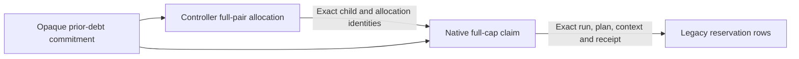

<!-- SPDX-License-Identifier: Apache-2.0 -->
# Read-only public parent accounting

Status: reviewed source contract; native qualification remains open. Owner: SAGE Foundation / Lantern maintainers. Updated: 2026-10-11. This extends [debt preflight](MESHTICULUM_DEBT_PREFLIGHT.md) and [paid parent claims](MESHTICULUM_PUBLIC_PARENT_CAPS.md). It grants no enrollment, start, refund, device window or publication approval.

A controller pays both endpoint maxima before preparation. Each native endpoint then records its local full-cap claim, resource lifetime, preparation and one-use start. Legacy journals retain reservations and uncertain outcomes. Reading these different records must not charge one allocation twice or replace its paid cap with smaller actual use.

The reader opens only existing protected public metadata. Native state has the fixed `parents/<parent_id>/native.sqlite` layout, with its existing owner, approval and pending files. Controller observation uses an explicitly selected protected public-controller directory and fixed `caps.sqlite` basename. Controller ownership must match the current effective UID; native observation requires root. A path or scope selects input; it is not approval or provenance authority.

Files are bounded, regular, single-link and opened without symlink traversal or creation. Existing owner locks remain nonblocking. SQLite receives held file bytes in query-only memory and never opens the native database pathname. WAL, shared-memory and rollback sidecars refuse a complete image observation. Native bytes, directory ownership and modes remain unchanged. Missing, busy, changed, fenced or unsupported data stays unavailable.

The native reader may also receive an exact legacy debt scope and read that scope directly through the existing protected run readers. Parent and legacy descriptors and locks survive final callbacks and checks. Caller dictionaries do not become verified native inputs. Relations require exact parent/policy, unit/boot, run, allocation/claim, child caps, public plan, grant context and stored preparation/start identities. Unmatched or null-cost rows stay visible; a plausible parent reference alone does not prove prepayment.

Reconciliation is diagnostic and consumes only in-process collected results. It preserves controller prior debt plus full pair allocations and native prior debt plus full claims as separate views. Matching records describe the same charged child; actual reservation rows are supporting evidence, never a refund. Opaque prior digests do not prove their contents or resolve historical overlap. Neither an expired policy nor a retired child erases debt or creates a fresh deadline.

The root launcher exposes `pilot-parent-snapshot <unit>` under a strict `meshticulum.public-parent-observation.v1` wrapper. Its fields are `schema`, `parent_scope`, `legacy_scope`, `runtime_sha256` and `manifest_sha256`. Parent scope uses `meshticulum.public-parent-snapshot-scope.v1`; legacy scope is null or the existing `meshticulum.public-debt-scope.v1`. Explicit scope-file hash, expected current boot and fixed observation end are required. The launcher permits native-role root observation only, validates the bundle/manifest and observes service/boot facts before and after. No serial, HAT, socket or radio worker opens. The full archive hash remains declared; manifest and payload verification do not observe that original archive hash.

Every result retains `complete_global_debt=False` and `eligible_for_enrollment=False`. A complete current inventory, independently qualified prior lineage, cross-host serialized provenance, current terminal/MCU observations, C containment and genuine owner approval remain external gates. The unresolved historical C child remains unknown. Source or installed-fixture checks cannot qualify these inputs, enroll a parent or authorize a physical campaign.

The frozen source passed 44 reader controls, 18 new launcher controls and the full 1,048-test integration suite with one expected skip on 287 unchanged Python inputs. The tests use temporary real files/SQLite with modeled UID, clock and native facts; they do not qualify deployment or physical state. Separate in-process snapshots do not establish an atomic cross-host observation.
