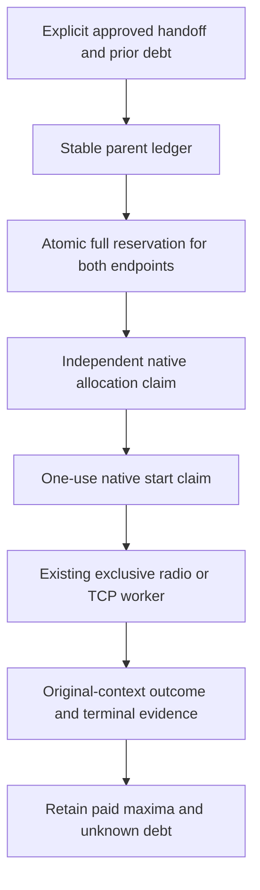

<!-- SPDX-License-Identifier: Apache-2.0 -->
# Public pilot parent accounting

Status: draft source contract. Version: 0.1. Owners: SAGE Foundation / Meshticulum and Lantern maintainers. Updated: 2026-10-11. Scope: Lantern public pilot accounting; native dispatch and release qualification remain open. This supplements the [public pilot guide](MESHTICULUM_PUBLIC_PILOT.md), without replacing historical evidence or granting a device window.

The current pilot creates independently bounded radio/IP children. It needs a durable parent across those children: a fresh campaign, grant or port must not replenish an approved handoff budget. This supports [SYS-003, SYS-006 and SYS-011](../REQUIREMENTS_TRACEABILITY.md): separate authority, connectivity without permission, and evidence for requirements. Meshticulum keeps generic flow, crypto, drivers and resources; Lantern owns this native policy and accounting integration.

The controller reservation and native claim are separate boundaries. A controller record cannot authorize a device. Each endpoint must independently validate its approved parent, current native facts, original host/resource clocks and exact allocation before a worker opens. The existing runner must consume a start claim once and preserve it on construction failure. Those native entry-point, package and receipt changes remain required; an isolated ledger or a callback returning true does not prove native enforcement.

## Standalone accounting component

[`pilot_parent_caps.py`](../../software/meshticulum-integration/src/lantern_meshticulum/bench/pilot_parent_caps.py) supplies typed costs, per-unit caps and a stable parent policy; pure extraction of the existing public packages; separate explicit enrollment/opening; atomic full-pair prepayment; and instance-owned one-use consumption. Private SQLite uses WAL/FULL synchronization, lifetime file ownership and a durable pending fence for uncertain commits. Opening preserves paid rows and cannot reconstruct permits. A final clock guard refuses an expired child even when the parent remains live. Supplied policy/prior dictionaries establish no native provenance.

The [35 focused controls](../../software/meshticulum-integration/tests/test_pilot_parent_caps.py) exercise real temporary SQLite and file locks with synthetic policies/clocks/packages. Independent bounded review accepted the ownership, final-observation, existing-response-source and permit repairs. This module is not yet called by the controller, CLI, native provisioner or radio/IP nodes. Native resource attachments, per-unit claims, one-use starts, debt import and public bundle/schema integration remain required before any new campaign is launched.

## Explicit parent and costs

First enrollment is a separate action with an explicitly approved stable parent ID, immutable policy digest, handoff bounds, controller/native boot identities, per-unit and aggregate caps, allowed peers/formats/transports, exact runtime/source pins and independently observed prior-debt snapshot bindings. Opening an existing parent never creates a missing ledger or new capacity. Resource attachments retain their original hash, expiry and native `original_context` deadline. Parent and resource deadlines must each remain current; neither can renew the other.

Use a five-axis integer cost vector: radio attempts, estimated radio airtime in microseconds, IP outgoing frames, TX stream bytes and RX stream bytes. Each reservation pays the actual enforced child maxima before any preparation. Current radio profiles cap each endpoint's AttemptJournal at 256 attempts and 60,000,000 estimated microseconds. Current default TCP limits cap each endpoint at 2,048 outgoing frames and 1,048,576 bytes in each stream direction. The separate radio cipher frame limit is 512; it is not an attempt count. DATA, ACK and retry costs share these caps.

A radio pair therefore prepays 512 attempts and 120,000,000 estimated microseconds; a default TCP pair prepays 4,096 frames and 2,097,152 bytes on each stream axis. Each unit's axis and any approved aggregate axis are checked in the same transaction. Do not add unlike axes. Estimated airtime is a reservation derived from the LoRa model, not measured airtime, energy or EIRP. TCP stream bytes exclude IP/TCP headers and kernel retransmissions.

No cancellation, unused child, partial preparation, lost return, smaller actual result, revocation, elapsed time or fresh run ID refunds that charge. Recovered records are debt and inspection evidence, not reconstructed instance permits. Unknown ownership requires explicit native reconciliation. An expected interrupted TCP reply remains paid; continuation also requires independent terminal/retirement evidence. Row presence, counters, process absence and flow ACKs cannot supply that evidence alone. MCU boot debt remains cumulative across grants, with no reset implied by this contract.

## Integration and evidence still required

The controller must prepay both endpoints atomically before its first `prepare()` call. A versioned parent-aware package must bind parent/policy, allocation, resource attachment, campaign/run, unit/direction, public format, object descriptor, pre-native plan digest, secret fingerprint and exact enforced caps. Native provisioning must claim before run enrollment and return the original native deadline and allocation binding. Controller and SSH code must verify that receipt before either start. Both radio and TCP runners must validate and consume the exact claim before their current journal, socket or driver construction and recheck it at actual setup/ARM boundaries. Result and retirement records must preserve that identity and debt.

Public bundle review must prove the new accounting module and callsites are included, while private providers remain excluded. Older parent-less packages and evidence remain historical; they do not authorize a parent-aware launch. Source persistence and fault controls cannot qualify current debt provenance, boot/clock observations, a device handoff, physical quiescence or public alpha readiness.

The prepared synthetic workload has four distinct near-limit signed chunks: 16,344 serialized bytes and 16,372 bytes per MR1 response. It tests transport capacity rather than ordinary knowledge content. A source seed containing all four fits the current 100,000-byte package limit; five near-limit chunks do not. Each sequential LoRa request/reply includes two 20-second receiver grace windows. Four such exchanges cannot fit the existing 160-second original resource window. A single mixed-path sample, repeated sustained distribution and failure/resume qualification need separately declared, feasible scopes and aggregate accounting. No clock extension, MCU reset or omitted failure is allowed to make a campaign fit.

Report RF sender-to-authenticated-flow-ACK useful-byte goodput separately from full request-to-publisher-verification latency. Retain every raw failure and unavailable measurement. Competitive comparison uses qualified Meshticulum results against primary published MeshCore/Reticulum figures with explicit conditions; no counterpart-stack campaigns are required.
