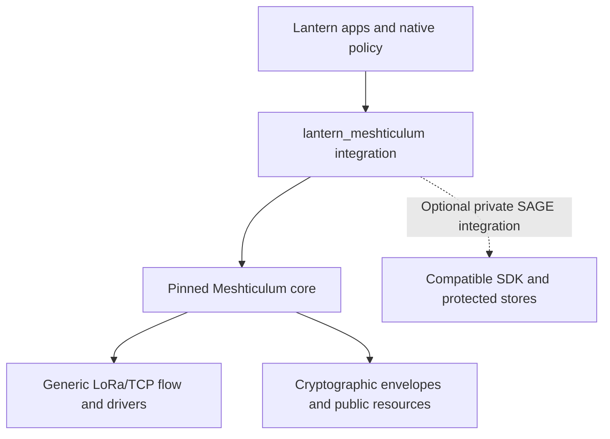

<!-- SPDX-License-Identifier: Apache-2.0 -->
# Candidate RFC: Meshticulum and Lantern repository boundary

| Record | Value |
| --- | --- |
| Status | CANDIDATE for source review; not ratified or a deployment approval |
| Version | 0.1 |
| Proposed owners | SAGE Foundation maintainers / Lantern engineering |
| Required reviewers | Product, engineering, security/privacy, operations, test and release; review outcomes pending |
| Created / last updated | 2026-10-10 |
| Target gate / decision deadline | Boundary review before merge; operational and publication review before their respective activation gates |
| Parent requirements | SYS-001, SYS-003, SYS-006, SYS-007, SYS-008, SYS-009, SYS-011; DST-001, DST-003, DST-004; FLE-001–003; SEC-001–003; API-001; OSS-001–002; GOV-001–002 |
| Proposed child requirements | LAN-MESH-BOUND-001–010, defined below; not yet adopted into the programme register |
| Dependencies | [Master PRD](../MASTER_TECHNICAL_PRD.md), [documentation governance](../DOCUMENTATION_GOVERNANCE.md), [requirement register](../REQUIREMENTS_TRACEABILITY.md), [Open Source Policy](../OPEN_SOURCE_POLICY.md), reviewed Meshticulum dependency |
| Supersedes / superseded by | None; historical source layout remains provenance |

## Summary and decision requested

Review a strict source and dependency boundary: [Meshticulum](https://github.com/l33tdawg/meshticulum/tree/0e240641d04b373402267c68cdf261a516a5156e) owns reusable cryptography, protocol, contracts, flow, scheduler, drivers and public resources. [SAGE Lantern](https://github.com/l33tdawg/sage-lantern) owns its application policy, protected SAGE integration, native nodes, device provisioning and fleet deployment. The dependency is **Lantern → Meshticulum**, with no reverse import or product-service prerequisite in the core.

The user requested this source boundary. This candidate records that intent and the reviewable migration contract; it does not declare normative approval, production enablement, hardware qualification or publication permission.

## Problem, evidence and users

The initial Meshticulum extraction also carried Lantern-specific inbox/capture, Linux unit roles, service-lifetime checks, provisioning and pilot tools. That made a transport repository appear to own a product's private and operational authority. It also made independent use and validation harder.

The migration candidate now places those implementations in `lantern_meshticulum`, while keeping their reusable dependency canonical in Meshticulum. Source controls and installed artifacts must be revalidated against the paired candidate commits. Historical tests, radio measurements and runtime hashes retain their original scope; relocating a file does not transfer qualification.

Affected users are application developers consuming Meshticulum, Lantern runtime engineers, private-backend integrators, device operators and release reviewers. Ordinary Lantern users gain no new traffic, consent decision or deployment action from this source change.

## Scope, non-goals and terminology

This RFC covers repository ownership, package/module boundaries, explicit dependency selection, host bundles, test-fixture consumption and migration evidence. It does not change wire formats, message signatures, canonical SAGE data, key enrollment, device identities, production service configuration or public validation authority.

“Core” means the independently reusable Meshticulum implementation. “Integration” means Lantern's `software/meshticulum-integration/` package. “Host bundle” means Lantern's content-addressed runtime archive, not an installed or armed device. “Quarantine” means durable transport-authenticated public bytes awaiting independent application verification.

The namespace is `lantern_meshticulum/{sage,bench,ip}`. Core imports use `meshticulum.*`. A package version is an API/dependency constraint; the reviewed source commit and inventory hashes establish the exact candidate input.

## Proposed contract and traceability

All child requirements below are **PROPOSED**. Their source is the user's requested boundary, this RFC and the listed accepted parent requirements. The common target milestone is reviewed boundary integration before release or activation. Test paths identify executable controls, not proof that a candidate run passed. Immutable paired-commit reports remain required before any row can be marked VERIFIED. Change history starts with this 2026-10-10 candidate.

| ID | Proposed requirement and rationale | Parent / owner | Acceptance method and source evidence |
| --- | --- | --- | --- |
| LAN-MESH-BOUND-001 | Lantern MUST depend on Meshticulum; Meshticulum MUST NOT depend on Lantern, the SAGE SDK or Lantern production services. This keeps transport reusable. | SYS-003, GOV-001 / architecture | Import/package scans, installed-core controls and dependency review |
| LAN-MESH-BOUND-002 | Lantern builders MUST require an explicit core source and reject inventory content mismatches. A release candidate MUST record its exact core revision, Lantern revision and artifact hashes. | SYS-011, OSS-001 / release | [`source_core.py`](../../firmware/meshticulum-bench/source_core.py), source-lock review and reproduced bundle manifests |
| LAN-MESH-BOUND-003 | Lantern MUST NOT maintain a second canonical crypto/flow/resource implementation. Compatibility imports MUST preserve module and class identity without changing sealed bytes. | API-001, SYS-009 / runtime | Runtime bridge identity controls, frozen-flow verification and installed-artifact imports |
| LAN-MESH-BOUND-004 | Native unit/profile policy, admission, provisioning, service checks, pilot control and deployment MUST remain Lantern-owned. Core construction MUST NOT confer those authorities. | SYS-003, SYS-006, FLE-001–003 / native integration | [`test_native_legacy_admission.py`](../../software/meshticulum-integration/tests/test_native_legacy_admission.py), pilot/node rejection controls and operational review |
| LAN-MESH-BOUND-005 | Fresh children and recovery MUST retain original peer/boot/expiry bindings, immutable resource deadlines and prior attempt/stream-byte/airtime debt. | SYS-009, FLE-003 / transport integration | [`test_pilot_context.py`](../../software/meshticulum-integration/tests/test_pilot_context.py), provisioning and failure/resume controls |
| LAN-MESH-BOUND-006 | Private admission MUST use the compatible SDK and actual native owner/consent/revocation lifecycle; a type, enable flag or codec MUST NOT substitute for it. | SYS-001, SYS-003, SEC-002 / private integration | [Private source controls](../../software/meshticulum-integration/tests/integrations/sage), plus independently witnessed backend/owner evidence before enablement |
| LAN-MESH-BOUND-007 | Public forwarding MUST use actual local authenticated quarantine. Responses MUST bind to the received request and verified public store; recipient caching MUST independently verify request, manifest, publisher and chunk. | SYS-006, SYS-008, DST-001, DST-004 / public integration | [`test_pilot_provision.py`](../../software/meshticulum-integration/tests/test_pilot_provision.py), [`test_pilot_resource_node.py`](../../software/meshticulum-integration/tests/test_pilot_resource_node.py), adversarial publisher controls |
| LAN-MESH-BOUND-008 | Claims MUST distinguish kernel acceptance, RF completion, peer receipt, durable bytes, publisher verification and SAGE admission. Unknown outcomes MUST remain visible and charged. | SYS-007, SYS-011, SEC-003 / operations/test | Raw per-stage receipts, failure/cleanup controls and physical run review |
| LAN-MESH-BOUND-009 | Shared core test fixtures MAY be consumed from an explicit development checkout. Tests and private fixture/evidence content MUST NOT enter wheels or device bundles. | SEC-003, OSS-001 / test/release | [`tests/conftest.py`](../../software/meshticulum-integration/tests/conftest.py), wheel/archive inventory inspection and privacy scans |
| LAN-MESH-BOUND-010 | Distribution MUST retain source, provenance, licenses and notices for core, Lantern and third-party inputs. A source move MUST NOT authorize installation, flashing or publication. | OSS-001–002, GOV-001 / maintainers/release | Paired artifact manifests, license inventory, explicit activation review and rollback evidence |

## Components and dependency topology

Lantern's integration consumes the core and, for its private path, the compatible SDK. No arrow grants permission, and none returns from the core into Lantern. The core raw firmware stays in Meshticulum; Lantern owns the external board/toolchain recipe and deployment. Host archives include the selected core as a pinned build input rather than a separately maintained source fork.

The package and builder guides are [integration README](../../software/meshticulum-integration/README.md) and [device-tooling README](../../firmware/meshticulum-bench/README.md).

## Authority, identities and keys

Lantern supplies independently observed unit/boot/service facts, native profile policy and current owner/dispatch leases. Provisioned peers and adjacent-link keys remain separate from personal SAGE identities. Root privileges, a source pin and current consent each establish different facts; none substitutes for the others.

Private application code holds the exact native lifecycle and protected-store/peer guards. It persists receive intention before DATA/ACK dispatch and complete sealed capture before inbox processing. Recovery first reconciles existing signed admission; old capture time, a new boot or a later grant cannot authorize fresh expired work.

Core changes must preserve original recipient encryption, sender authentication, signatures, replay/counter continuity and flow credit. This RFC grants no new enrollment, federation, validator, public publication or protected-store capability.

## Data, API and schema boundaries

The source move changes import ownership, not wire identity. Generic envelope and carrier schemas remain core-owned. Lantern owns native pilot packages, source/provisioning receipts, original host-local resource contexts, service lifetime observations and application decisions. Record versioned schemas and exact format/object/deadline bindings in each candidate's evidence.

Public quarantine is not a verified cache or canonical SAGE memory. Private sealed capture does not enter `BlockServer` or public stores. Keys, payloads, identity material and operational credentials are excluded from ordinary diagnostics and published fixtures. Retention and recovery remain governed by their existing application and operational contracts.

The public host bundle excludes the `sage` provider and tests and keeps private services disabled. Installing the optional SDK extra cannot enable private dispatch. Each direction of a public MR1 exchange still requires current independent admission; a source migration is not route negotiation or permission renewal.

## Failure, abuse and security model

| Condition | Required containment |
| --- | --- |
| Missing or mismatched core source | Refuse the build; preserve prior reviewed inputs and artifacts |
| Wrong host/boot/profile, changed active file or expired deadline | Refuse new dispatch or admission; retain failure evidence and original debt |
| Forged, replayed or rebound frames | Keep authentication/replay refusal; do not grant credit or application trust |
| Management-supplied replacement reply | Refuse native response substitution; use the received request and local verified store |
| Unknown socket/device/write outcome | Fence or reconcile under original state; do not infer delivery or refund costs |
| Missing real private lifecycle or incompatible SDK | Keep private dispatch disabled |
| Process observation timeout or controller expiry | Poll the actual handle and perform bounded owned cleanup; do not infer quiescence from a state file |

Threats include reverse dependency creep, duplicate crypto/class identity, substituted build input, secret-bearing artifacts, admission laundering through root access or management, and promotion of lower-level receipts into application authority. Independent security/privacy review must cover those flows before normative approval. Native protected directories and SQLite durability do not alone prove hardware rollback resistance.

## Compatibility, migration and rollback

The migration moves application modules into `lantern_meshticulum`; Meshticulum removes them and its SAGE extra/product entry points. The legacy runtime `sage_lantern.mesh_envelope` import aliases the canonical core module, preserving identity rather than copying code. Lantern's private controls are updated to consume core interfaces from their own package.

Review both candidate revisions together. Keep original provenance and acceptance controls, use an explicit core checkout for shared synthetic fixtures, and validate wheels/bundles independently of a developer's parent checkout. Do not deploy tests or retain undeclared fallback imports.

No device rollout occurs under this RFC. Any later rollout needs its own exact artifacts, current ownership, compatibility/rollback plan and finite authorization. Source rollback uses the previous paired revisions; device rollback requires separately retained and reviewed recovery artifacts. Neither erases original journal debt or rewrites personal state.

## Observability and capacity

Record source locks, paired commits, build manifests, validation scope, grant and original deadline bindings, actual process handles, per-stage receipts and cleanup outcomes. Keep failed, skipped and unavailable measurements visible. Diagnostics remain bounded and payload-free by default.

The repository split makes no throughput, power or latency improvement claim. Historical radio results remain bound to their original runtime. Host/controller gaps, verification and receiver grace belong in whole-resource elapsed time; stream bytes and radio airtime retain separate accounting. The 1–1.5 kB/s programme target and matched MeshCore/Reticulum comparison remain separate qualification work.

## Test plan and deployment gates

1. Run core boundary, protocol/resource, frozen-flow and installed-artifact controls against the exact Meshticulum candidate.
2. Run Lantern native/public integration controls with the explicit matching core fixture checkout. Confirm no reverse runtime dependency and inspect wheel/archive contents.
3. Run compatible-SDK private controls, legacy runtime regression and module-identity checks. Label modeled owners and SDK MockTransport accurately.
4. Produce content-addressed reports for both commits and the artifact pins; reviewer acceptance remains separate from a passing local run.
5. Before native enablement, obtain fresh device ownership and finite grants, preserve production services, and witness disarm/cleanup and retained failure/debt.
6. Qualify actual mixed LoRa/IP, loss with fresh LoRa admission and verified-piece resume, locally measured route return, and real private lifecycle/backend independently. Source tests do not complete these gates.

The detailed [public-pilot runbook](MESHTICULUM_PUBLIC_PILOT.md) is a Lantern qualification plan. It does not authorize current execution or override product radio policy.

## License and publication impact

Retain Apache-2.0 project attribution, SAGE Foundation and Dhillon Andrew Kannabhiran (@l33tdawg) stewardship, donor provenance and third-party licenses. Meshticulum's raw radio source, Lantern wrappers, reconstructed BSP/toolchains and distributed artifacts have distinct inventories. Unknown or incompatible licenses continue to block distribution under OSS-002.

A reviewed source split does not create an alpha tag, change either repository's visibility, publish packages or qualify production hardware. Public/production release needs its exact artifact and evidence review.

## Alternatives and unresolved decisions

Keeping product adapters in Meshticulum would retain the reverse ownership ambiguity. Duplicating the core in Lantern would create independent wire and class identities and make fixes drift. An implicit sibling checkout would hide build provenance. The candidate instead keeps one core implementation and explicit, content-pinned dependency inputs.

| Open item | Owner / deadline / blocked gate | Safe default |
| --- | --- | --- |
| OPEN-MESH-BOUND-001: final paired source pins, reproducible artifact reports and child-ID registration | Engineering/test/release; before boundary review closes and before distribution | Candidate only; no accepted or released artifact claim |
| OPEN-MESH-BOUND-002: independent threat/privacy and operational review | Security/privacy/operations; before normative approval or native enablement | Preserve existing authority boundaries; private dispatch disabled |
| OPEN-MESH-BOUND-003: product radio policy versus bounded synthetic resource pilots | Product/architecture; before any product resource-over-LoRa enablement | DST-003 and Master PRD remain in force: production bulk stays off LoRa |
| OPEN-MESH-BOUND-004: full firmware/BSP reproducibility and third-party inventory | Hardware/release; before distributing or qualifying the paired firmware | Source/build preparation only; no portable provisioning or public firmware claim |

The generic core's ability to carry resource bytes is not an amendment to Lantern's accepted DST-003 or Master PRD distribution rules. Bounded synthetic lab qualification must remain explicitly scoped. Any product-policy change requires its own reviewed RFC delta; this source-boundary RFC does not grant that change.

**Decision/dissent log:** 2026-10-10 — user requested the strict one-way source boundary; candidate documentation and migration prepared. Normative review outcomes, acceptance evidence and any dissent remain unrecorded. No ratification, deployment or publication decision is asserted.
